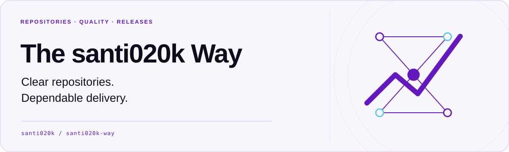

<p align="center">
  <a href="README.md">
    <picture>
      <source media="(prefers-color-scheme: dark)" srcset="docs/assets/readme/hero-dark.svg">
      
    </picture>
  </a>
</p>

<h1 align="center">The santi020k Way</h1>

<p align="center">Practical standards for clear repositories and dependable delivery.</p>

<p align="center">
  <a href="LICENSE"></a>
  <a href="package.json"></a>
</p>

Shared design language, library choices, architecture decisions, and working agreements for
Santiago-owned projects—available to Codex, Claude Code, and people from the same versioned sources.

**v0.1.0 is prepared locally.** The website target is [way.santi020k.com](https://way.santi020k.com);
remote publication and deployment require the setup described in the [release plan](docs/release-v0.1.0.md).

## Start locally

Requires Node >=22.18 and pnpm 10.34.3.

```sh
pnpm install --frozen-lockfile
pnpm build
pnpm way list
pnpm way search "design"
pnpm way read packages
pnpm dev
```

The website opens at `http://127.0.0.1:4328`. Use `pnpm check`, `pnpm format:check`, and
`pnpm test:browser` for validation (install Chromium with `pnpm exec playwright install chromium`).

## Add it to your agent

```sh
# Preview first; writes require the approval hash from this preview.
pnpm way setup codex
pnpm way setup claude

# Install the generated Codex plugin marketplace.
codex plugin marketplace add ./packages/plugin/dist/codex
codex plugin add santi020k-way@santi020k-way

# Load the Claude Code plugin for a session.
claude --plugin-dir ./packages/plugin/dist/claude/santi020k-way
```

The plugin supplies build, review and release skills plus a read-only MCP server. Its tools search
and retrieve the packaged standards without reading arbitrary files or sending your code anywhere.
The CLI separately manages global instructions with preview, backup and rollback. Your model,
permissions, trusted directories, credentials and other runtime settings remain local. Optional
MCP-only examples live in `config/`; avoid registering the server twice.

## Workspace

| Location              | Responsibility                                                                 |
| --------------------- | ------------------------------------------------------------------------------ |
| `standards/`          | Shared guidance, original global policy, scoped decisions and catalog metadata |
| `packages/way/`       | `@santi020k/way`: CLI, typed catalog, read-only MCP and safe instruction setup |
| `skills/`             | Focused source workflows for build, review and release                         |
| `packages/plugin/`    | Generated Codex and Claude marketplace distributions                           |
| `apps/website/`       | Astro documentation site using Lumen and Theme                                 |
| `docs/`, `templates/` | Existing engineering standards, reusable templates and release guidance        |

Turborepo builds the catalog before its plugin and website consumers. Generated copies are never
edited by hand. Read the [implementation guide](docs/implementation.md) for ownership, privacy,
compatibility decisions and verification boundaries.

## Release resources

- [Preferred tools and usage guides](standards/packages.md)
- [Release standard](docs/release-standard.md)
- [Repository presentation standard](docs/repository-presentation-standard.md)
- [Professional library README template](templates/README-library.md)
- [Professional product README template](templates/README-product.md)
- [Semantic pull request titles](docs/pull-request-standard.md)
- [Repository audit](docs/repository-audit.md)
- [Quality without a mute button](docs/quality-standard.md)
- [Changesets workflow template](templates/changesets-release.yml)
- [PR title workflow template](templates/pr-title.yml)
- [Tagged native release checklist](templates/tagged-native-release.md)
- [Agent quality policy](templates/agent-quality-policy.md)

## Audit sibling repositories

Run the audit from this repository while it remains beside the other projects:

```bash
pnpm audit:releases
pnpm audit:presentation
pnpm audit:quality
pnpm audit:pull-requests
```

The commands print Markdown inventories and report missing presentation, release, or quality
safeguards across the sibling projects.

## Scope

This repository records shared defaults, not rigid rules. A package release, a notarized macOS
application, a TestFlight build, and a Cloudflare deployment have different mechanics. They should
share safety properties without pretending to be the same operation.

## Find your next step

| Resource                                               | Use it for                                                |
| ------------------------------------------------------ | --------------------------------------------------------- |
| [Repository audit](docs/repository-audit.md)           | Review sibling repositories against the shared standards. |
| [Library README template](templates/README-library.md) | A reusable starting point for package documentation.      |
| [Product README template](templates/README-product.md) | A reusable starting point for application documentation.  |

## License

MIT. See [LICENSE](LICENSE).
